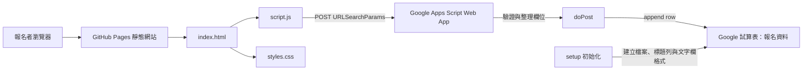
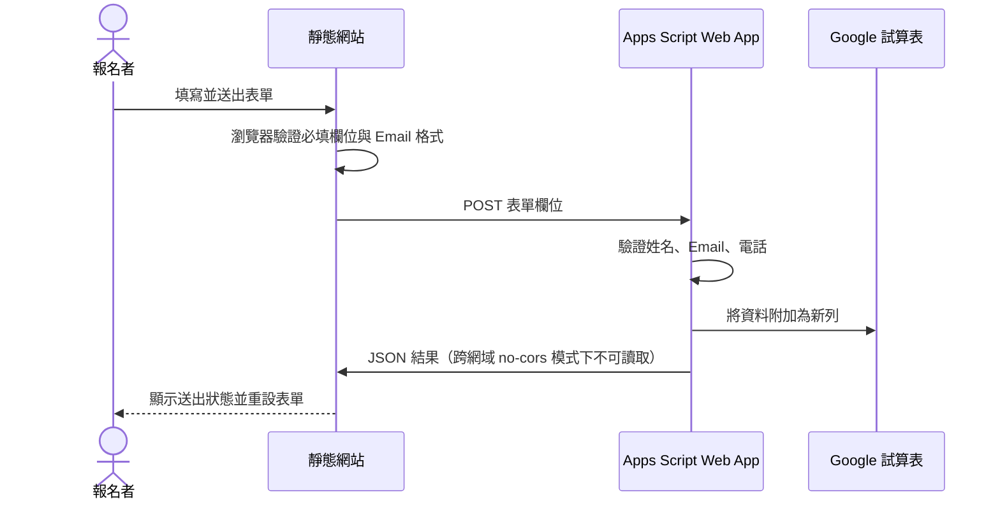

# 員工旅遊報名系統文件

最後更新：2026-10-30

## 1. 系統摘要

本系統提供數位科技公司員工旅遊活動介紹與線上報名。前端是無建置步驟的靜態 HTML、CSS、JavaScript 網站，透過 GitHub Pages 發布；報名資料由 Google Apps Script Web App 接收，再寫入 Google 試算表。

- 公開網站：https://paijiping.github.io/2026_active/
- GitHub Repo：https://github.com/paijiping/2026_active
- Google 試算表：[2026_員工旅遊](https://docs.google.com/spreadsheets/d/1Foa76KjWNUMSXWW-5lx9h7MD-wklFCahu-v-2NAFP88/edit)
- 工作表分頁：`報名資料`

GitHub Repo 名稱與試算表檔名不同：GitHub Repo 使用 `2026_active`，試算表使用 `2026_員工旅遊`。

## 2. 架構



### 2.1 報名資料流程



## 3. 程式元件

| 路徑 | 職責 |
| --- | --- |
| `index.html` | 活動頁結構、標題、主視覺、活動內容與報名表單 |
| `styles.css` | 色彩、排版、響應式樣式與動態效果；封面依 `1774:887` 原圖比例呈現 |
| `script.js` | 表單事件處理、欄位整理、Apps Script POST 與狀態訊息 |
| `cover.jpg` | 活動主視覺；實際影像內容為 PNG，尺寸 `1774 × 887` |
| `apps-script/Code.gs` | 試算表初始化、輸入驗證、資料附加與 JSON 回應 |
| `README.md` | 專案連結、Apps Script 部署與本機預覽說明 |
| `.gitignore` | 排除 `spec/`、`.DS_Store` |
| `spec/prompt.md` | 原始需求；僅留在本機，不納入 Git Repo |

前端不使用 npm、框架或編譯流程。部署時直接發布根目錄中的 HTML、CSS、JavaScript 與圖片。

## 4. 頁面結構

頁面由上而下包含三列：

1. 活動標題。
2. 圓角活動圖片，依原始影像長寬比完整顯示。
3. 活動內容與報名表單。桌機為左右兩欄，窄螢幕改為上下排列。

表單欄位：

| 欄位 | 必填 | 前端型態 |
| --- | --- | --- |
| 姓名 | 是 | text |
| Email | 是 | email |
| 單位 | 否 | text |
| 電話 | 是 | tel；以字串送出以保留前導零 |
| 職稱 | 否 | text |

## 5. 試算表資料結構

試算表檔名為 `2026_員工旅遊`，分頁名稱為 `報名資料`。第一列欄位如下：

| 欄 | 標題 | 儲存內容 | 說明 |
| --- | --- | --- | --- |
| A | 姓名 | 文字 | 必填 |
| B | Email | 文字 | 必填；Apps Script 另做基本格式驗證 |
| C | 單位 | 文字 | 選填 |
| D | 電話 | 純文字 | 必填；整欄格式設為 `@`，保留 `0` 開頭 |
| E | 職稱 | 文字 | 選填 |
| F | 報名時間 | 日期時間 | Apps Script 寫入伺服器執行時的日期 |

## 6. Apps Script 行為

### `setup()`

- 從 Script Properties 讀取 `SPREADSHEET_ID`。
- 若尚無 ID，建立 `2026_員工旅遊` 試算表；若已有 ID，開啟既有試算表。
- 將分頁命名為 `報名資料`，寫入標題列、凍結首列並套用粗體。
- 將 D 欄電話格式設為純文字 `@`。
- 將試算表 ID 存回 Script Properties。
- 回傳試算表網址。

### `doPost(event)`

- 從 `event.parameter` 讀取 `name`、`email`、`department`、`phone`、`title`。
- 要求姓名、Email、電話不得為空，並檢查 Email 的基本格式。
- 將欄位去除前後空白後寫入下一列；寫入前再把該列 D 欄設定為純文字。
- 回傳包含 `ok` 與訊息的 JSON。

Web App 以擁有者身分執行、存取權設定為「所有人」，因此報名者不需要登入 Google，但資料仍寫入擁有者的試算表。

## 7. 部署與維護

### GitHub Pages

- Repo：`paijiping/2026_active`
- 分支：`main`
- 發布來源：根目錄
- 網址：https://paijiping.github.io/2026_active/
- 推送前端變更到 `main` 後，GitHub Actions 會建置並發布 Pages。

### Apps Script

Apps Script 專案是獨立於 Git Repo 的部署。`apps-script/Code.gs` 是版本控制中的來源檔；修改後需同步至 Apps Script 編輯器並建立新部署版本。若 Web App URL 改變，需同步修改 `script.js` 最上方的 `APPS_SCRIPT_URL`，再推送前端更新。

### 本機預覽

在專案根目錄執行：

```sh
python3 -m http.server 8000
```

開啟 `http://localhost:8000`。本機預覽仍會連到程式中設定的 Apps Script Web App；測試表單可能寫入正式試算表。

## 8. 驗證方式

- 在瀏覽器確認頁面有三列；桌機第三列為左右欄，手機為上下排列。
- 確認封面原圖尺寸為 `1774 × 887`，渲染比例維持 `1774:887`，`object-fit` 為 `contain`。
- 以桌機與手機寬度檢查沒有水平溢位。
- 送出測試報名後，確認試算表新增一列、標題欄位順序正確，電話前導零仍保留。
- Pages 發布後，確認 GitHub Actions 的 `pages-build-deployment` 成功，並由公開網址檢查更新。

## 9. 限制與安全注意事項

- 前端使用 `fetch(..., { mode: "no-cors" })` 以避開跨來源預檢；瀏覽器因此無法讀取 Apps Script 回傳的 HTTP 狀態或 JSON。現行前端在請求未丟出網路錯誤時顯示成功訊息，不能單獨據此證明資料已寫入；正式驗證需查看 Google 試算表。
- Apps Script Web App 對所有人開放，具基本必填與 Email 驗證，但目前沒有驗證碼、速率限制或垃圾報名偵測。請勿在表單收集高度敏感資料，並定期檢查試算表。
- 試算表不應設為公開分享。公開的是提交端點，不代表試算表需要公開。
- `cover.jpg` 副檔名與實際 PNG 編碼不同；瀏覽器目前能正常解碼。替換圖片時應同步確認 GitHub Pages 的 MIME 與瀏覽器載入結果。
